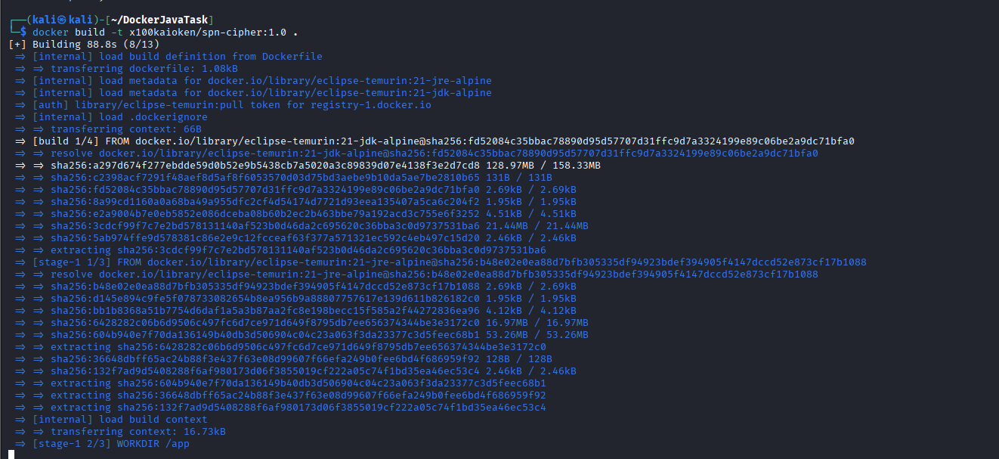
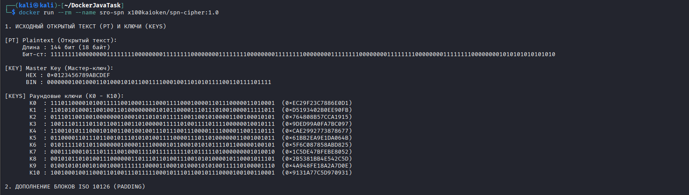
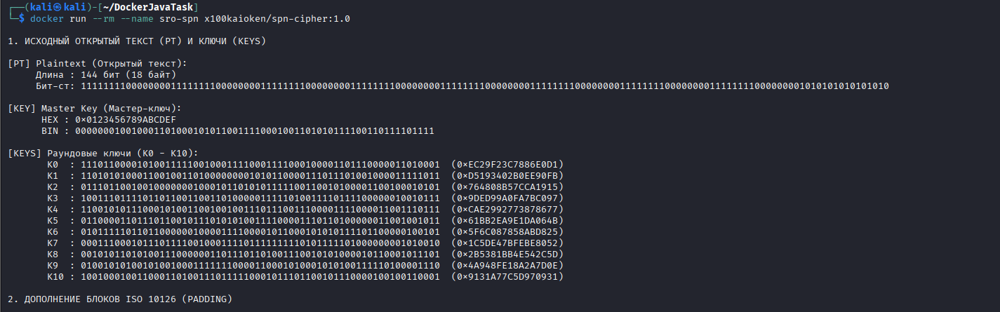

# СРО: Контейнеризация Java-приложения (SPN-шифр)
В качестве приложения используется **собственная реализация блочного SPN-шифра** на Java
(S-Box из ГОСТ «Кузнечик», режимы шифрования ECB и CBC, паддинг ISO 10126). Это консольная
программа: при запуске она шифрует заданный открытый текст, выводит раундовые ключи,
пошаговую трассировку SPN-сети, результаты ECB и CBC и проверку обратной расшифровки.

Исходный код взят из отдельного проекта: https://github.com/X100KAIOKEN/KriptographySPN

Ссылка на мой DockerHub с образами "[https://hub.docker.com/u/x100kaioken?_gl=1*p1ca9o*_gcl_au*MTA1NDk4OTE2NS4xNzkzMTU1MTUyLjE2MDg2MDExNjkuMTc5MzMzNjU5MC4xNzkzMzM2NTg5LjU1ODk1Nzg1MS4xNzkzMzM2NTkwLjE3OTMzMzY1ODk.*_ga*NjA0MDMyNTIxLjE3OTMxNTUxNTI.*_ga_XJWPQMJYHQ*czE3OTMzNDI2MDMkbzYkZzEkdDE3OTMzNDI2OTUkajUxJGwwJGgwhttps://hub.docker.com/u/x100kaioken?_gl=1*p1ca9o*_gcl_au*MTA1NDk4OTE2NS4xNzkzMTU1MTUyLjE2MDg2MDExNjkuMTc5MzMzNjU5MC4xNzkzMzM2NTg5LjU1ODk1Nzg1MS4xNzkzMzM2NTkwLjE3OTMzMzY1ODk.*_ga*NjA0MDMyNTIxLjE3OTMxNTUxNTI.*_ga_XJWPQMJYHQ*czE3OTMzNDI2MDMkbzYkZzEkdDE3OTMzNDI2OTUkajUxJGwwJGgw](https://hub.docker.com/r/x100kaioken/spn-cipher)"

| Параметр | Значение |
|----------|----------|
| Docker Hub | `x100kaioken/spn-cipher:1.0` |
| Базовый образ | `eclipse-temurin:21` (JDK для сборки, JRE для запуска) |
| Язык | Java 21 |
| Тип | консольное приложение (не веб-сервер) |

---

## Структура репозитория

```
DockerJavaTask/
├── Dockerfile            # многоэтапная сборка: JDK -> JRE
├── src/                  # исходники SPN-шифра (.java)
├── docker-compose.yml    # то же самое одной командой
├── .dockerignore
├── screenshots/          # скриншоты выполнения
└── README.md
```

---

## О Dockerfile (многоэтапная сборка)

Образ собирается в два этапа, чтобы финальный образ был меньше:

1. **Этап сборки** — берётся образ с JDK (компилятором), исходники компилируются
   командой `javac` в `.class`-файлы.
2. **Этап запуска** — берётся лёгкий образ только с JRE, в него копируются уже
   готовые `.class`. Компилятор в итоговый образ не попадает.

Переменная `LANG=C.UTF-8` и флаги `-Dstdout.encoding=UTF-8` нужны, чтобы кириллица
в выводе отображалась корректно.

---

## 1. Сборка своего образа

```bash
cd DockerJavaTask
docker build -t x100kaioken/spn-cipher:1.0 .
docker images | grep spn-cipher
```

| Часть команды | Назначение |
|---------------|-----------|
| `docker build` | собирает образ по инструкциям из `Dockerfile` |
| `-t x100kaioken/spn-cipher:1.0` | имя:тег образа (`логин/имя:версия`) |
| `.` | контекст сборки — текущая папка |



---

## 2. Запуск контейнера

Программа одноразовая: запускается, печатает результат и завершается. Поэтому запускаем
её на переднем плане (без `-d`), чтобы сразу видеть вывод. `--rm` удаляет контейнер
после завершения.

```bash
docker run --rm --name sro-spn x100kaioken/spn-cipher:1.0
```



В выводе видно: открытый текст и ключи, раундовые ключи K0–K10, дополнение ISO 10126,
трассировку раундов, шифротексты ECB и CBC и проверку восстановления
(`Совпадение с PT : true`).

> Если запускать в фоне через `-d`, контейнер сразу перейдёт в статус `Exited`, потому что
> программа отработала и завершилась — это нормально. Посмотреть вывод тогда можно командой
> `docker logs sro-spn`.

---

## 3. Публикация на Docker Hub

```bash
docker login
docker push x100kaioken/spn-cipher:1.0
```



После публикации образ доступен всем командой:

```bash
docker pull x100kaioken/spn-cipher:1.0
```

Репозиторий на Docker Hub (Public): `x100kaioken/spn-cipher`.

---

## Удаление

```bash
docker rmi x100kaioken/spn-cipher:1.0    # удалить образ локально
```

(Контейнер удаляется сам благодаря флагу `--rm`.)

## Стек

Kali Linux, Docker, Java 21 (Eclipse Temurin), Docker Hub.

## Автор

Алихан Лютов (Docker Hub: `x100kaioken`)
